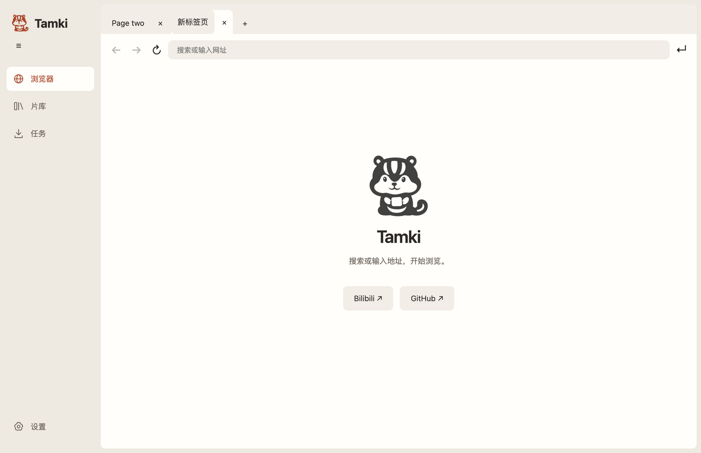

<div align="center">
  
  <h1>Tamki</h1>
  <p>A browser for discovering videos. A library across your own storage.</p>
  <p><a href="README.md">English</a> · <a href="README.zh-CN.md">简体中文</a></p>
  <p><a href="LICENSE"></a></p>
</div>

Tamki is an early desktop project that starts with a Chromium browser and will grow into video collection, playback and library management across user-selected storage. ZSpace NAS is the first planned storage integration.

## Current implementation

**0.1.0 is a browser foundation, not a complete video downloader.** It uses Electron 45.3.1, Chromium, TypeScript and WebContentsView.

- Create, close and switch tabs; open website popups in tabs.
- Enter web addresses or search; navigate back/forward and reload/stop.
- Keep website sessions in a dedicated persistent browser profile.
- Collapse the sidebar; follow the system light/dark appearance.
- Switch the application shell between English and Simplified Chinese.
- Save ordinary website attachments through the native download dialog.

Library, Tasks and storage settings are reserved entries. **Video detection, episode downloads, NAS/cloud connections, indexing, collections, library playback and migration are not implemented in this build.** There is no public installer release yet.



## Direction

The planned workflow is to browse, discover a video, choose a destination, and play or organize it from one aggregated library. Storage connections and multiple library roots belong in Settings. Downloads and storage transfers will share one task area.

The interface uses a chipmunk mark, warm neutral surfaces and a restrained hazel accent. Spacing and surface colors carry most of the hierarchy.

## Develop

Use Node.js **22.12+** and npm. Electron downloads its platform runtime on first use; allow access to its official release assets.

```sh
npm ci
npm run check
npm test
npm start
```

Shortcuts: `Cmd/Ctrl+L` focuses the address field, `Cmd/Ctrl+T` creates a tab, `Cmd/Ctrl+W` closes the current tab, and `Cmd/Ctrl+R` reloads it. `Ctrl+Tab` switches tabs on systems where the key event reaches the application.

```sh
npm run test:browser
npm run package
```

The browser integration test starts an isolated local HTTP fixture and uses a temporary profile. It does not use your real website accounts. Packaging writes an unsigned development bundle for the current platform to `packages/`; it is not a signed or notarized installer.

Validated locally on macOS Apple Silicon. Windows and Linux source paths are present, but native runtime behavior has not yet been validated there.

## Browser boundaries

Remote content runs without Node integration or an application preload, with sandboxing and context isolation enabled. The local shell has a narrow IPC bridge with sender validation. Remote navigation is limited to HTTP(S); site permission requests currently default to deny. Camera, microphone, notification and location permission management still needs a user interface.

This build does not include bookmarks, a history manager, password management, tab restoration, browser account sync, extension installation or automatic updates. Electron supports only part of Chrome's extension APIs; it does not provide general Chrome Web Store compatibility. Media codec and DRM compatibility must be tested separately. See [Electron's extension documentation](https://www.electronjs.org/docs/latest/api/extensions) and [security guidance](https://www.electronjs.org/docs/latest/tutorial/security).

## Contribute

See [CONTRIBUTING.md](CONTRIBUTING.md). Keep both README versions aligned and describe only verified behavior as implemented. Do not commit private storage paths, accounts, tokens, browser profiles or personal media.

MIT licensed. Maintained by CNJ-Devs.
