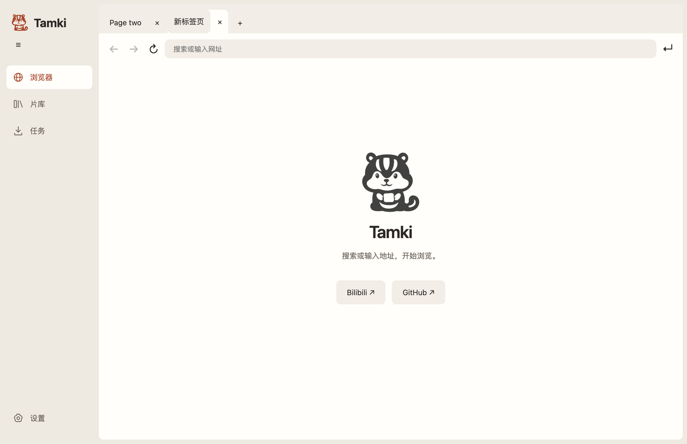

<div align="center">
  
  <h1>Tamki</h1>
  <p>浏览发现视频，在自己的存储里管理片库。</p>
  <p><a href="README.md">English</a> · <a href="README.zh-CN.md">简体中文</a></p>
  <p><a href="LICENSE"></a></p>
</div>

Tamki 是一个从 Chromium 浏览器开始的桌面项目，计划逐步支持视频收集、播放，以及跨自定义存储位置的片库管理。首个计划接入的存储是极空间 NAS。

## 当前实现

**0.1.0 是浏览器底座，还不是完整的视频下载工具。** 使用 Electron 45.3.1、Chromium、TypeScript 与 WebContentsView。

- 新建、关闭、切换标签页；将网页弹出窗口放入标签页。
- 输入网址或搜索，前进、后退、刷新与停止加载。
- 使用独立持久浏览器会话保存网站登录状态。
- 收起侧栏，跟随系统明暗主题。
- 应用界面可切换英文与简体中文。
- 网页普通附件下载使用系统保存弹窗。

片库、任务和存储设置目前是预留入口。**视频抓取、剧集下载、NAS/网盘连接、索引、合集、片库播放与迁移尚未接入。** 当前没有公开安装包发布。



## 产品方向

预期流程是浏览网页、发现视频、选择保存位置，再从聚合片库播放和整理。存储连接及多个片源目录放在设置中，下载和存储迁移放在统一任务区。

界面采用花栗鼠标志、暖中性色和少量榛果橙。主要通过留白与底色区分层级。

## 开发

安装 Node.js **22.12+** 与 npm。首次使用时 Electron 会下载对应平台运行时，需要能够访问官方发布资源。

```sh
npm ci
npm run check
npm test
npm start
```

快捷键：`Cmd/Ctrl+L` 聚焦地址栏，`Cmd/Ctrl+T` 新建标签页，`Cmd/Ctrl+W` 关闭当前标签页，`Cmd/Ctrl+R` 刷新。系统允许该按键事件传入应用时，`Ctrl+Tab` 可以切换标签页。

```sh
npm run test:browser
npm run package
```

浏览器集成测试使用本地 HTTP 测试页面和临时浏览器配置，不使用真实网站账号。打包命令在 `packages/` 下生成当前平台的未签名开发包，不是签名或公证后的安装程序。

本地在 macOS Apple Silicon 上验证。源码保留 Windows 和 Linux 的运行路径，但尚未完成这两个系统的原生运行验证。

## 浏览器能力边界

远程网页禁用 Node 集成，不加载应用 preload，并启用沙箱与上下文隔离。本地界面通过有限 IPC 接口操作浏览器，主进程校验调用来源。网页导航限于 HTTP(S)；站点权限请求当前默认拒绝，摄像头、麦克风、通知和定位等权限管理界面尚待补齐。

当前没有书签、历史记录管理、密码管理、标签恢复、浏览器账号同步、扩展安装和自动更新。Electron 只支持部分 Chrome 扩展 API，不能承诺通用 Chrome 商店兼容。媒体编码与 DRM 兼容需单独验证。参见 [Electron 扩展文档](https://www.electronjs.org/docs/latest/api/extensions)和[安全建议](https://www.electronjs.org/docs/latest/tutorial/security)。

## 参与贡献

参见 [CONTRIBUTING.md](CONTRIBUTING.md)。保持两份 README 内容一致，只把已经验证的功能标为已实现。不要提交私人存储路径、账号、令牌、浏览器配置和个人媒体。

采用 MIT 许可证，由 CNJ-Devs 维护。
